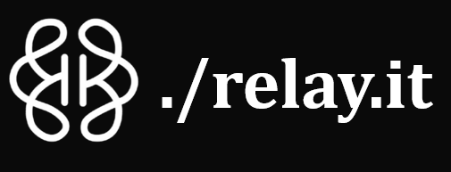
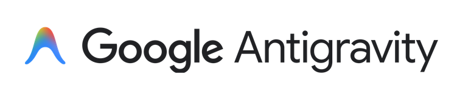
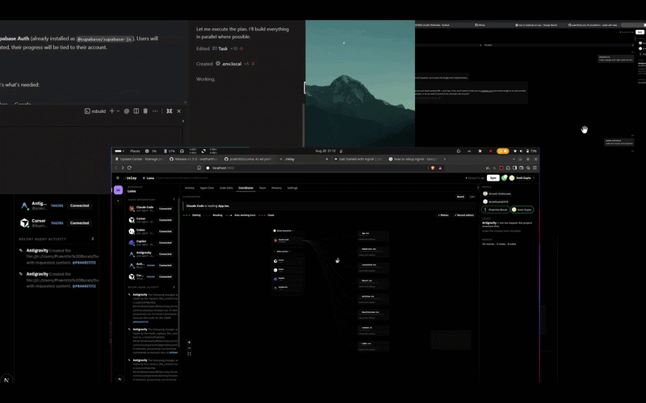

<div align="center">



### GitHub Desktop for AI agents.

*Git coordinates humans committing minutes apart. **Latch coordinates agents editing the same files right now** — file locks, dependency-aware locks, live patch sync, and one shared board.*

**Twelve agents on one repo, and none of them blind to the others.**

[**Watch the demo**](https://youtu.be/vUea5Qih-nM) · [**Read the Documentation**](https://latch-brain.vercel.app/docs.html) · [**Docs in this repo**](./docs/README.md)

<br/>

<a href="https://nodejs.org"></a>
<a href="LICENSE"></a>


<br/>
<br/>

**Works with**

<p align="center">
  
  
  
  <br />
  
  
</p>

</div>

## The problem

Eighteen months ago you had **one** coding assistant. Today you probably have **three running at once** — Claude in one terminal, Cursor in another, Copilot in the editor. They all write to the same files, and not one of them knows the others exist.

Now put **four people** on that repo. That's **twelve agents**, editing the same code, blind to each other. You find out at the merge. Or you don't find out at all.

Git solved this for humans — but Git assumes people committing at human speed, minutes apart, one branch each. **Agents write at machine speed, in parallel, in the same directory.** There is no layer for that.

## The fix

```diff
- 12 agents · 12 blind writers · conflicts discovered at merge
+ 12 agents · 1 lock table · conflicts prevented at the edit
```

Latch sits under every agent as a **coordination layer**. Pre-tool hooks claim a lock before an agent writes; post-tool hooks release it. If one agent is modifying a component, another **cannot silently overwrite** those changes.

> **One host, no backend.** One person runs `latch serve` — that machine *is* the server. Everyone else connects over an ngrok tunnel, straight to that laptop. Nothing lives on infrastructure you do not own.

<div align="center">



**[Watch the full demo on YouTube](https://youtu.be/vUea5Qih-nM)**

</div>

## The four pillars

| | What it does |
|---|---|
| **File locking** | Every agent write goes through a claim/release cycle against a shared lock table (TTL-based, auto-expiring). Destructive overwrites are blocked, not detected after the fact. |
| **Dependency-graph locking** | Files do not exist independently — one change can affect dozens. Latch parses imports with tree-sitter and asks *"does this change affect files another agent is working on?"*, not just *"is this exact file locked?"* Agents stay parallel; the blast radius stays safe. |
| **Patch sync across machines** | Your teammate has their own filesystem, environment, and agents. Latch propagates **patches**, not whole-project copies — `latch push` / `latch pull` keep every clone on the same working state. |
| **Mission Control** | One board for every agent on every machine: live lock table, lock graph, code edits, unified agent chat history, conflicts, presence. |

## Quick start

**Host** — the machine everyone else connects to:

```bash
latch login              # GitHub identity (uses the gh CLI)
latch clone <repo-url>   # clone + register workspace + install agent hooks
latch serve              # API → 127.0.0.1:3001 · Mission Control → :3002
```

Then open Mission Control → **Team → Share** to mint the ngrok invite link.

**Teammate:**

```bash
latch serve              # their own local latch
# join with the host's invite link on the Team tab
latch pull               # take the host's current working state
```

Now start agents as usual. Hooks claim and release locks automatically — nobody has to remember a command.

<details>
<summary><strong>Install options</strong></summary>

<br/>

| Method | Command |
|--------|---------|
| local dev | `npm i`, then `npm link` in this repo |
| attach an existing repo | `latch add /path/to/repo` |
| fresh clone | `latch clone <url> [dir]` |

Requires **Node.js 18+** (20+ recommended). No database, no hosted backend, no login server.

</details>

## How it works

```text
  Cursor ──┐  pre-tool hook: claim
  Claude ──┤  post-tool hook: release      ┌──────────────┐
  Copilot ─┼──► lock table ◄── dep graph ──│ latch serve  │──► Mission Control
  Codex ───┤        ▲                      │  (your host) │          ▲
  Antigravity ┘     │                      └──────┬───────┘          │
                    │       ngrok tunnel          │                  │
              teammate's latch ◄──── patches ─────┴──────────────────┘
```

| Layer | Who runs it | What it guards |
|-------|-------------|----------------|
| **Claim / release** | pre- and post-tool hooks | exclusive write access to a file |
| **Dependency graph** | tree-sitter import scan | files *affected by* the edit, not just the edit |
| **Room** | `latch serve` + ngrok tunnel | one shared lock table across machines |
| **Patches** | `latch push` / `latch pull` | working-tree state without full copies |
| **Board** | Mission Control (:3002) | who holds what, right now |

> Locks and the board are separate subsystems — hooks arbitrate straight against the host, while the board is fed by a mirror. `latch doctor` walks that chain and tells you which link is broken.

## Commands

| Command | Description |
|---------|-------------|
| `latch login` / `logout` / `whoami` | GitHub identity (via `gh` CLI, or device flow with `GITHUB_CLIENT_ID`) |
| `latch clone <url> [dir]` | git clone + register workspace + install agent hooks |
| `latch add <path>` | Attach an existing local repo |
| `latch init [path]` | Wire hooks, Latch MCP, and `/latch ask` instructions for all agents |
| `latch serve` | API on `127.0.0.1:3001` + Mission Control on `:3002` |
| `latch serve --no-ui` | API + coordinator only |
| `latch push` | Send your dirty working-tree files to the shared room |
| `latch pull` | Apply the host's current dirty files onto this clone |
| `latch status` | Health check (room, role, host, ports) |
| `latch mcp-url` | Print the MCP config for this room's shared-context endpoint |
| `latch doctor` | Diagnose an empty Coordinator board |

## Mission Control

Started by `latch serve` — runs on your own machine, no hosted account.

| | URL |
|---|-----|
| Dashboard | http://localhost:3002 |
| API | http://127.0.0.1:3001/api/health |

**Collisions prevented counter** (persisted to `~/.latch/data/projects/<id>/collisions.json` and mirrored to `<repo>/.latch/collisions.json`).

## MCP — shared room context

Any MCP client can read the room's context, **even on a machine with no latch installed**:

```bash
latch mcp-url    # prints a ready-to-paste mcpServers block
```

Coordination tools (`latch_claim_file`, `latch_release_file`, `latch_status`) run against each member's own local latch. The room endpoint is **read-only** for anyone off the host machine.

<details>
<summary><strong>Tools exposed</strong></summary>

<br/>

| Tool | Purpose |
|------|---------|
| `latch_claim_file` | Acquire an exclusive write lock before editing |
| `latch_release_file` | Release the lock after editing |
| `latch_status` | View the full lock table |
| `latch_get_conflicts` | Overlapping edits in the last 5 minutes |
| `latch_get_recent_changes` | Recent `code_edit` events |
| `latch_get_chat_history` | Unified agent chat across every room member |
| `latch_room_brief` | Teammate activity brief (for the `/latch ask` agent pseudo-command) |
| `latch_get_collision_stats` | Lifetime counters for collisions Latch prevented |
| `latch_report_change` | Push a code-change event |
| `latch_report_decision` / `latch_get_decisions` | Append / read decisions |
| `latch_update_task` / `latch_get_active_tasks` | Append / read tasks |
| `latch_get_project_context` | Full JSON project context |
| `latch_sync` | Re-read agent transcripts into unified history |

</details>

## Hooks

`latch clone` / `latch add` / `latch init` install pre-tool (**claim**), post-tool (**release**), pre-read, stop hooks, **Latch MCP** (`latch_room_brief` for `/latch ask`), and the latch-os instruction block into every agent surface:

| Agent | Hooks | Instructions | Latch MCP (`latch_room_brief`) |
|-------|--------|--------------|--------------------------------|
| Claude Code | `.claude/settings.json` | `CLAUDE.md` | `.claude/settings.json` → `mcpServers.latch` |
| Cursor | `.cursor/hooks.json` | `.cursor/rules/latch.mdc`, `AGENTS.md` | `.cursor/mcp.json` |
| Codex | `.codex/hooks.json` | `AGENTS.md` | `.codex/config.toml` → `[mcp_servers.latch]` |
| Copilot CLI | `.github/hooks/latch-os.json` | `.github/copilot-instructions.md` | `.github/mcp.json` |
| Antigravity | `.agents/hooks.json` | `AGENTS.md` | `.agents/mcp_config.json` |

Languages parsed for the dependency graph: TypeScript/JavaScript, Python, Go, Rust, Java, C#, C/C++, PHP, Ruby.

## Dependencies

| | |
|---|---|
| **Required** | Node.js 18+ (20+ recommended), npm |
| **Bundled** | `express`, `cors`, `ws`, `@vscode/tree-sitter-wasm` · `next`, `react` (Mission Control) |
| **Not needed** | MongoDB, Redis, Docker, a hosted backend, an account |
| **Optional** | `gh` CLI for `latch login` · ngrok for cross-machine rooms |

**Env vars:** `LATCH_PORT` (3001) · `LATCH_UI_PORT` (3002) · `LATCH_UI_ORIGIN`

## Documentation

Full documentation lives in [`docs/`](./docs/README.md).

| | |
|---|---|
| [Quickstart](./docs/QUICKSTART.md) | Coordinating in about five minutes |
| [Installation](./docs/INSTALLATION.md) | Requirements, install methods, what gets written where |
| [Concepts](./docs/CONCEPTS.md) | Workspace, project, agent ID, lock, room, patch |
| [Rooms and teams](./docs/ROOMS.md) | Hosting, invites, member tokens, joining, leaving |
| [Architecture](./docs/ARCHITECTURE.md) | Process model, the two planes, one edit end to end |
| [Locking](./docs/LOCKING.md) | The lock table, TTLs, ownership, dependency-graph soft locks |
| [Sync and patches](./docs/SYNC.md) | Patch format, Lamport ordering, transform, transcripts |
| [CLI reference](./docs/CLI.md) | Every command, flag and exit code |
| [HTTP API reference](./docs/HTTP-API.md) | Every endpoint, with auth rules |
| [MCP reference](./docs/MCP.md) | The fifteen tools and the read-only room endpoint |
| [Hooks reference](./docs/HOOKS.md) | The hook contract per agent |
| [Configuration](./docs/CONFIGURATION.md) | Environment variables, ports, on-disk layout |
| [Troubleshooting](./docs/TROUBLESHOOTING.md) | `latch doctor` and the known failure modes |

## Roadmap

- **Git worktree isolation** — every agent in its own workspace off the same repository, free to experiment and test independently, integrated back into main when the work is ready.
- Richer conflict resolution on top of the existing OT / patch layer.

<div align="center">

**We used Latch to build Latch.** The problem we were solving was the problem we were having.

The next time you build a hackathon project, do not just add more agents. **Just latch.it**

<sub>MIT licensed · Your machine is the server.</sub>

</div>
