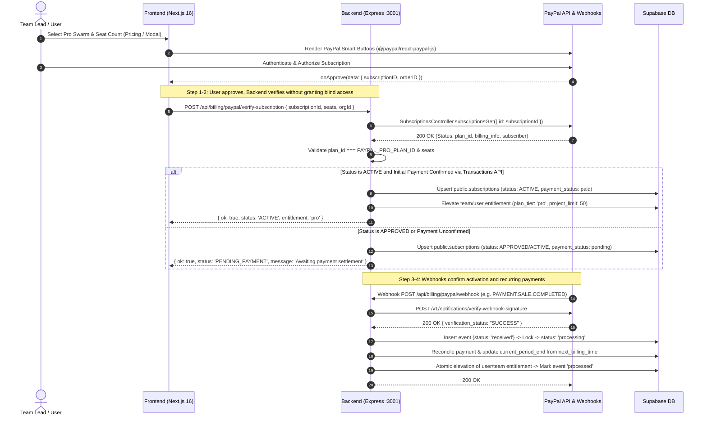

# Revised PayPal SDK & Sandbox Payment Integration Plan — LATCH Pro Swarm (v3)

> **Target Branch:** `feat/payment-paypal-sdk`  
> **Status:** Implementation Plan / Technical Specification (Reviewed & Corrected — Final)  
> **Pricing Baseline:** LATCH Pro Swarm at **$24 per seat · month**

---

## 1. System Architecture & Lifecycle Sequence

### 1.1 State Distinction in PayPal Subscriptions
To guarantee financial and entitlement integrity, the system strictly distinguishes between distinct lifecycle states:
1. **Subscription Approval (`APPROVED` / Client `onApprove`):** Buyer completed the PayPal checkout UI and authorized billing. **Does not grant Pro access.**
2. **Backend Verification (`VERIFYING`):** Authenticated backend retrieves the subscription via PayPal API (`subscriptionsGet`) to verify plan ID, merchant context, seat count, and current status.
3. **Subscription Activation (`ACTIVE`):** PayPal confirms the agreement is operational (`BILLING.SUBSCRIPTION.ACTIVATED`).
4. **Payment Confirmation (`PAID`):** Confirmed strictly through a verified `PAYMENT.SALE.COMPLETED` webhook event or by querying the PayPal Subscription Transactions API (`GET /v1/billing/subscriptions/{id}/transactions`). *(Note: PayPal's `billing_info.last_payment` contains only `amount` and `time`—it does not have a status field).*
5. **Paid Billing Period (`current_period_start` to `current_period_end`):** The authoritative active window:
   - `current_period_start`: mapped from `billing_info.last_payment.time` (or `start_time` for cycle 1).
   - `current_period_end`: mapped strictly from `billing_info.next_billing_time`.
6. **Cancellation vs. Paid-Through Retained Access:** Calling PayPal's cancellation endpoint cancels *future* automated billing in PayPal immediately. Locally, our entitlement system retains Pro access through the verified `current_period_end` date that was already paid for.
7. **Payment Failure & Grace Period:** A failed recurring payment enters a defined 3-day grace period (`grace_period_until = now() + 3 days`). Access is revoked only if payment remains unsettled past the grace deadline.



---

## 2. SDK & API Selection Analysis

### 2.1 Frontend SDK: `@paypal/react-paypal-js`
- **Package:** `@paypal/react-paypal-js` (compatible with Next.js 16 and React 19).
- **Options:** `<PayPalScriptProvider>` initialized with:
  - `clientId`: `process.env.NEXT_PUBLIC_PAYPAL_CLIENT_ID`
  - `intent`: `"subscription"`
  - `vault`: `true`
  - `components`: `"buttons"`
- **Component:** `<PayPalButtons>` implementing `createSubscription` with `plan_id`, `quantity` (seat count), and `custom_id` (`userId` or `orgId`).

### 2.2 Backend SDK: `@paypal/paypal-server-sdk`
- **Package:** `@paypal/paypal-server-sdk` (v2.5.0).
- **Client Configuration:**
  ```javascript
  const { Client, Environment, LogLevel } = require("@paypal/paypal-server-sdk");

  const paypalClient = new Client({
    clientCredentialsAuthCredentials: {
      oAuthClientId: process.env.PAYPAL_CLIENT_ID,
      oAuthClientSecret: process.env.PAYPAL_CLIENT_SECRET,
    },
    environment: process.env.PAYPAL_MODE === "live" ? Environment.Production : Environment.Sandbox,
    logging: { logLevel: process.env.NODE_ENV === "production" ? LogLevel.Warn : LogLevel.Info },
  });
  ```
- **Controllers & Operations:**
  - `SubscriptionsController`:
    - `subscriptionsGet({ id })`: Fetch full subscription record, status, subscriber, and `billing_info`.
    - `subscriptionsCancel({ id, body: { reason } })`: Cancels future recurring debits in PayPal.
    - `subscriptionsRevise({ id, body: { planId, quantity } })`: Seat upgrade/downgrade.
  - **Payment Verification:**
    - Primary verification: Asynchronous `PAYMENT.SALE.COMPLETED` webhook.
    - Synchronous fallback verification: Query subscription transactions via PayPal REST API `GET /v1/billing/subscriptions/{id}/transactions` checking for completed sales.
  - `Webhook Signature Verification`:
    - Signature verification calls PayPal's verification endpoint (`POST /v1/notifications/verify-webhook-signature`) using the authenticated client.

### 2.3 Account Eligibility & Currency Requirements
- **Prerequisites:**
  - Active PayPal Business Account eligible for Subscriptions API.
  - Subscriptions API access must be enabled in the developer dashboard.
  - **Currency:** Must be configured in supported currencies (e.g. `USD`). Note that PayPal Subscriptions **does not support INR**; international billing must use USD or another supported currency.

---

## 3. Database Schema and Billing State (`backend/supabase/schema.sql`)

```sql
-- 1. Dedicated Subscriptions Table
CREATE TABLE IF NOT EXISTS public.subscriptions (
    id UUID PRIMARY KEY DEFAULT gen_random_uuid(),
    user_id UUID NOT NULL REFERENCES auth.users(id) ON DELETE CASCADE,
    organization_id UUID, -- For team-level seat ownership
    paypal_subscription_id TEXT UNIQUE NOT NULL,
    plan_id TEXT NOT NULL,
    status TEXT NOT NULL CHECK (status IN (
        'APPROVAL_PENDING',
        'APPROVED',
        'ACTIVE',
        'SUSPENDED',
        'CANCELLED',
        'EXPIRED'
    )),
    payment_status TEXT NOT NULL DEFAULT 'unpaid' CHECK (payment_status IN (
        'unpaid',
        'pending',
        'paid',
        'failed'
    )),
    seats INTEGER NOT NULL DEFAULT 1 CHECK (seats >= 1),
    payer_email TEXT,
    paypal_payer_id TEXT,
    start_time TIMESTAMPTZ,
    current_period_start TIMESTAMPTZ,
    current_period_end TIMESTAMPTZ,
    grace_period_until TIMESTAMPTZ,
    cancelled_at TIMESTAMPTZ,
    created_at TIMESTAMPTZ NOT NULL DEFAULT now(),
    updated_at TIMESTAMPTZ NOT NULL DEFAULT now()
);

CREATE INDEX IF NOT EXISTS idx_subscriptions_user ON public.subscriptions(user_id);
CREATE INDEX IF NOT EXISTS idx_subscriptions_org ON public.subscriptions(organization_id);
CREATE INDEX IF NOT EXISTS idx_subscriptions_status_period ON public.subscriptions(status, current_period_end);

-- 2. Transactional Webhook Audit & Idempotency Table
CREATE TABLE IF NOT EXISTS public.billing_events (
    id UUID PRIMARY KEY DEFAULT gen_random_uuid(),
    event_id TEXT UNIQUE NOT NULL,
    event_type TEXT NOT NULL,
    resource_id TEXT NOT NULL,
    resource_type TEXT NOT NULL,
    summary TEXT,
    payload JSONB NOT NULL,
    status TEXT NOT NULL DEFAULT 'received' CHECK (status IN (
        'received',
        'processing',
        'processed',
        'failed'
    )),
    error_message TEXT,
    created_at TIMESTAMPTZ NOT NULL DEFAULT now(),
    processed_at TIMESTAMPTZ
);

CREATE INDEX IF NOT EXISTS idx_billing_events_event_id ON public.billing_events(event_id);
CREATE INDEX IF NOT EXISTS idx_billing_events_resource ON public.billing_events(resource_id);

-- 3. Entitlement Tracking on Users / Organizations
ALTER TABLE public.users ADD COLUMN IF NOT EXISTS plan_tier TEXT NOT NULL DEFAULT 'free' CHECK (plan_tier IN ('free', 'pro'));
ALTER TABLE public.users ADD COLUMN IF NOT EXISTS active_subscription_id UUID REFERENCES public.subscriptions(id) ON DELETE SET NULL;
ALTER TABLE public.users ADD COLUMN IF NOT EXISTS seats_allocated INTEGER NOT NULL DEFAULT 1;

-- 4. Atomic Subscription Expiry & User Downgrade RPC Function
CREATE OR REPLACE FUNCTION public.reconcile_expired_subscriptions()
RETURNS TABLE (
    subscription_id UUID,
    user_id UUID,
    organization_id UUID
)
LANGUAGE plpgsql
SECURITY DEFINER
AS $$
BEGIN
    RETURN QUERY
    WITH expired_candidates AS (
        SELECT s.id, s.user_id, s.organization_id
        FROM public.subscriptions s
        WHERE s.status IN ('ACTIVE', 'SUSPENDED', 'CANCELLED')
          AND COALESCE(s.grace_period_until, s.current_period_end) < now()
        FOR UPDATE SKIP LOCKED
    ),
    updated_subs AS (
        UPDATE public.subscriptions s
        SET status = 'EXPIRED', updated_at = now()
        FROM expired_candidates c
        WHERE s.id = c.id
        RETURNING s.id, s.user_id, s.organization_id
    ),
    downgraded_users AS (
        UPDATE public.users u
        SET plan_tier = 'free',
            project_limit = 3,
            seats_allocated = 1,
            active_subscription_id = NULL
        FROM updated_subs us
        WHERE u.id = us.user_id
          -- Ensure user has no other active valid subscriptions
          AND NOT EXISTS (
              SELECT 1 FROM public.subscriptions other
              WHERE other.user_id = u.id
                AND other.id != us.id
                AND other.status = 'ACTIVE'
                AND other.current_period_end > now()
          )
        RETURNING u.id
    )
    SELECT us.id AS subscription_id, us.user_id, us.organization_id
    FROM updated_subs us;
END;
$$;
```

---

## 4. Webhook Handling Architecture (`POST /api/billing/paypal/webhook`)

### 4.1 Framework Request Body Preservation
PayPal signature verification requires the exact, unmodified raw request body string. In Express:
```javascript
app.use("/api/billing/paypal/webhook", express.json({
  verify: (req, _res, buf) => {
    req.rawBody = buf.toString("utf8");
  }
}));
```

### 4.2 Webhook Signature Verification & Simulator Isolation
Extract headers:
- `paypal-auth-algo`
- `paypal-cert-url` (must be validated against `https://api.sandbox.paypal.com` or `https://api.paypal.com`)
- `paypal-transmission-id`
- `paypal-transmission-sig`
- `paypal-transmission-time`

Verify via `POST /v1/notifications/verify-webhook-signature`. If signature fails, return HTTP 400 and abort.

> [!CAUTION]
> **Strict Webhook Simulator Isolation:**  
> PayPal confirms that Webhook Simulator mock events generate synthetic signatures that **fail live postback verification**.  
> - The bypass flag `PAYPAL_BYPASS_WEBHOOK_VERIFICATION` is **strictly prohibited in production**.
> - At application startup:
>   ```javascript
>   if (process.env.NODE_ENV === "production" && process.env.PAYPAL_BYPASS_WEBHOOK_VERIFICATION === "true") {
>     throw new Error("FATAL: PAYPAL_BYPASS_WEBHOOK_VERIFICATION cannot be enabled in production.");
>   }
>   ```
> - In non-production environments with bypass enabled, mock events must never elevate real user entitlements; they must target sandbox/test fixtures exclusively. Real sandbox testing must be conducted using real sandbox buyer checkouts, which generate fully verifiable webhooks.

### 4.3 Transactional State Machine for Webhook Processing
To prevent duplicate processing or missed retries:
1. **Insert:** Attempt `INSERT INTO public.billing_events (event_id, event_type, resource_id, resource_type, payload, status) VALUES (...)`.  
   - If unique constraint violated (`event_id` exists):
     - If existing status is `'processed'`, return `200 OK` (idempotent no-op).
     - If existing status is `'processing'`, return `429` / `503` so PayPal retries shortly.
     - If existing status is `'failed'`, allow re-attempt.
2. **Transition:** Update status to `'processing'`.
3. **Execute:** Execute business logic within an atomic transaction.
4. **Finalize:**
   - On success: `UPDATE billing_events SET status = 'processed', processed_at = now()`.
   - On exception: `UPDATE billing_events SET status = 'failed', error_message = $1`. Return HTTP 500 so PayPal queues a retry.

### 4.4 Webhook Event Matrix & Payment Reconciliation

| Event Type | Exact Trigger | Actions & Entitlement Impact |
| :--- | :--- | :--- |
| `BILLING.SUBSCRIPTION.ACTIVATED` | Subscription agreement activated | Update `subscriptions.status = 'ACTIVE'`. **Check payment:** If `payment_status !== 'paid'`, do not elevate to Pro yet. Wait for `PAYMENT.SALE.COMPLETED` or verify transactions. |
| `PAYMENT.SALE.COMPLETED` | Initial or renewal payment cleared | Set `payment_status = 'paid'`. Set `current_period_start = event.resource.create_time`. Update `current_period_end` from subscription's `next_billing_time`. Reset `grace_period_until = null`. **Elevate user/org to `plan_tier = 'pro'`, `project_limit = 50`.** |
| `BILLING.SUBSCRIPTION.PAYMENT.FAILED` | Recurring card charge failed | Set `payment_status = 'failed'`, `grace_period_until = now() + interval '3 days'`. **Retain Pro access during grace period.** Send payment failure alert. |
| `BILLING.SUBSCRIPTION.CANCELLED` | User/merchant cancelled in PayPal | Set `subscriptions.cancelled_at = now()`, `status = 'CANCELLED'`. **Do not revoke immediately if paid:** If `current_period_end > now()`, retain Pro access locally until period end. If already past due, revoke immediately. |
| `BILLING.SUBSCRIPTION.SUSPENDED` | Max retries failed or admin paused | Set `status = 'SUSPENDED'`, `payment_status = 'failed'`. Immediately revoke Pro access (`plan_tier = 'free'`, `project_limit = 3`). |
| `BILLING.SUBSCRIPTION.EXPIRED` | Final billing period elapsed | Set `status = 'EXPIRED'`. Downgrade `plan_tier = 'free'`, `project_limit = 3`. |
| `BILLING.SUBSCRIPTION.UPDATED` | Seats or tier revised | Update `seats` count; re-verify configured plan. |

---

## 5. Cancellation, Expiry & Entitlement Enforcement

### 5.1 Cancellation Architecture: Future Debits vs. Local Access
- **PayPal API Cancellation:** Invoking `SubscriptionsController.subscriptionsCancel({ id, body: { reason } })` instructs PayPal to cancel the subscription agreement immediately. **PayPal will not execute any future recurring charges.**
- **Local Entitlement Retention:** Cancelling PayPal recurring debits does not wipe out days the user already paid for. If `current_period_end > now()`, the subscription status is marked `CANCELLED` locally, but `requireProEntitlement` continues granting Pro access until `current_period_end`.
- **Scheduled Cancellation Clarification:** We do not rely on PayPal to delay cancellation. We cancel future billing in PayPal immediately and handle the paid-through policy locally.

### 5.2 Request-Time Entitlement Enforcement (Primary Security Boundary)
Every protected backend endpoint (project creation >3, unlimited agent swarms, cloud AST locks) verifies access via `requireProEntitlement` middleware:
1. Load user/team record: check `plan_tier === 'pro'`.
2. Inspect active subscription:
   - If `status == 'ACTIVE'` AND `payment_status == 'paid'` AND `current_period_end > now()`: **Allow**.
   - If `status == 'CANCELLED'` AND `payment_status == 'paid'` AND `current_period_end > now()`: **Allow** (paid through end of period).
   - If `grace_period_until > now()`: **Allow** with warning header (`X-Latch-Grace-Period-Ending`).
   - If `current_period_end <= now()`: **Deny (403)** and trigger synchronous DB downgrade.

### 5.3 Scheduled Expiry Synchronization RPC Job
- **Runner:** `backend/jobs/subscriptionReaper.js`, run every hour in the backend daemon.
- **Atomic Database Function:** Invokes `public.reconcile_expired_subscriptions()`. This single PostgreSQL transaction locks candidates with `FOR UPDATE SKIP LOCKED`, updates subscription records to `EXPIRED`, and resets user entitlements to Free in a single atomic commit.
- **Post-Commit Notification:** Only after the database transaction commits successfully does Node emit SSE events (`entitlement_changed`) to connected browser clients. If SSE delivery fails, data integrity remains intact, and request-time guards enforce the downgrade.

---

## 6. Team Seats & Ownership Model

- **Subscription Ownership:** Subscriptions are tied to `user_id` (the purchaser/billing owner) with an optional `organization_id` for team-based attribution.
- **Seat Enforcement:** `seats` is a verified integer stored in `subscriptions.seats`.
- **Seat Allocation:** The billing owner can invite team members up to the total purchased seat count (`seats_allocated <= subscriptions.seats`). When `plan_tier` is revoked, all members under that organization revert to Free limits.

---

## 7. Proposed Exact File Changes

### Backend (`backend/`)
1. **`backend/services/PayPalService.js` (NEW):**
   - Configures `@paypal/paypal-server-sdk` Client.
   - Wraps `SubscriptionsController.subscriptionsGet`, `subscriptionsCancel`, `subscriptionsRevise`.
   - Implements transactions lookup fallback via PayPal REST API.
   - Implements webhook signature verification with strict production bypass guards.
2. **`backend/routes/billingRoutes.js` (NEW):**
   - `POST /api/billing/paypal/verify-subscription`: Validates frontend `onApprove` data via PayPal SDK; updates DB with `APPROVED` or `ACTIVE` state.
   - `POST /api/billing/paypal/webhook`: Handles verified lifecycle events with the transactional state machine.
   - `GET /api/billing/subscription`: Returns current user/org subscription, seats, and next billing date.
   - `POST /api/billing/subscription/cancel`: Cancels PayPal recurring charges and retains local access until `current_period_end`.
3. **`backend/middleware/entitlement.js` (NEW):**
   - Middleware enforcing Pro limits and validating active subscription status at request time.
4. **`backend/jobs/subscriptionReaper.js` (NEW):**
   - Hourly reconciliation runner invoking the atomic `reconcile_expired_subscriptions()` RPC.
5. **`backend/app.js` (MODIFY):**
   - Configure raw body capture for `/api/billing/paypal/webhook`.
   - Register billing routes under `/api/billing`.
   - Start `subscriptionReaper` on startup.
6. **`backend/supabase/schema.sql` (MODIFY):**
   - Append `subscriptions`, `billing_events`, user tier columns, and the `reconcile_expired_subscriptions()` function.

### Frontend (`frontend/`)
1. **`frontend/components/billing/PayPalSubscriptionButton.tsx` (NEW):**
   - Uses `@paypal/react-paypal-js` `<PayPalButtons>`.
   - Handles `createSubscription`, `onApprove`, and error/retry states.
2. **`frontend/components/billing/UpgradeModal.tsx` (NEW):**
   - Seat selection stepper ($24 × N seats/month calculation).
   - Embedded PayPal Smart Buttons.
3. **`frontend/components/landing/PricingTiers.tsx` (MODIFY):**
   - Connect Pro Swarm CTA to checkout flow.
4. **`frontend/app/dashboard/page.tsx` (MODIFY):**
   - Display billing status card, current seats, and project limit upgrade CTA.
5. **`frontend/app/(auth)/signup/page.tsx` (MODIFY):**
   - Retain upgrade intent during registration without granting unverified Pro status.

---

## 8. Environment Variables Specification

### Root `.env.example`
```env
# PayPal API Configuration
PAYPAL_MODE=sandbox
PAYPAL_CLIENT_ID=your_sandbox_client_id_here
PAYPAL_CLIENT_SECRET=your_sandbox_client_secret_here
PAYPAL_PRO_PLAN_ID=P-XXXXXXXXXXXXXXXXXXXXXXXX
PAYPAL_WEBHOOK_ID=your_sandbox_webhook_id_here

# Strictly for local test-suite simulation (prohibited in production)
PAYPAL_BYPASS_WEBHOOK_VERIFICATION=false

# Supabase Service Role (for webhook and reaper background synchronization)
SUPABASE_SERVICE_ROLE_KEY=your_service_role_key_here
```

### Frontend `.env.example` (`frontend/.env.example`)
```env
# PayPal Client Configuration
NEXT_PUBLIC_PAYPAL_CLIENT_ID=your_sandbox_client_id_here
NEXT_PUBLIC_PAYPAL_PRO_PLAN_ID=P-XXXXXXXXXXXXXXXXXXXXXXXX
```

---

## 9. Comprehensive Testing Matrix (14 Scenarios)

| # | Test Scenario | Execution Method | Expected Result |
| :- | :--- | :--- | :--- |
| **1** | Approval & Verification Without Payment | `onApprove` completes; payment still processing | Sub recorded as `APPROVED`/`ACTIVE` with `payment_status = 'pending'`; Pro access **not** granted yet. |
| **2** | Initial Payment Confirmation | `PAYMENT.SALE.COMPLETED` webhook arrives | `payment_status = 'paid'`, `current_period_end` set to `next_billing_time`, Pro access granted. |
| **3** | Out-of-Order: Payment Before Activation | Sale webhook arrives before activation webhook | Sale record created; when activation is confirmed, access elevated smoothly. |
| **4** | Invalid Plan ID / Tampered Seats | Post altered `plan_id` to verify endpoint | Backend rejects with 400 Bad Request; zero access granted. |
| **5** | Cryptographic Webhook Verification | Post webhook with invalid headers | Signature check fails; returns 400; event discarded. |
| **6** | Duplicate Webhook Delivery | Deliver identical webhook `event_id` twice | First processes; second caught by `billing_events(event_id)` and returns 200 without duplicate actions. |
| **7** | Webhook Processing Failure & Safe Retry | Force error during webhook processing | Event marked `failed`; subsequent retry transitions back to `processing` and succeeds. |
| **8** | Recurring Renewal Success | `PAYMENT.SALE.COMPLETED` for recurring cycle | `current_period_end` updated to new `next_billing_time`; grace period reset. |
| **9** | Recurring Payment Failure (Grace Period) | `BILLING.SUBSCRIPTION.PAYMENT.FAILED` arrives | Enters 3-day grace period; Pro access preserved; user alerted. |
| **10** | Cancellation With Paid Time Remaining | Cancel subscription via API | PayPal future billing stopped immediately; Pro access retained until `current_period_end`. |
| **11** | Automatic Revocation on Expiry | Run `subscriptionReaper` calling RPC | Subscription marked `EXPIRED` and user downgraded atomically in a single Postgres transaction. |
| **12** | Multi-Instance Reaper Safety | Run `subscriptionReaper` concurrently in parallel processes | `FOR UPDATE SKIP LOCKED` ensures each expired row is processed exactly once without race conditions. |
| **13** | Webhook Simulator Guard in Production | Set bypass to true with `NODE_ENV=production` | App server throws fatal error on boot, preventing insecure deployment. |
| **14** | Free Tier Regressions | Test project creation and local locks on Free tier | Free limits (3 projects) strictly enforced; no impact on local CLI daemon workflows. |
